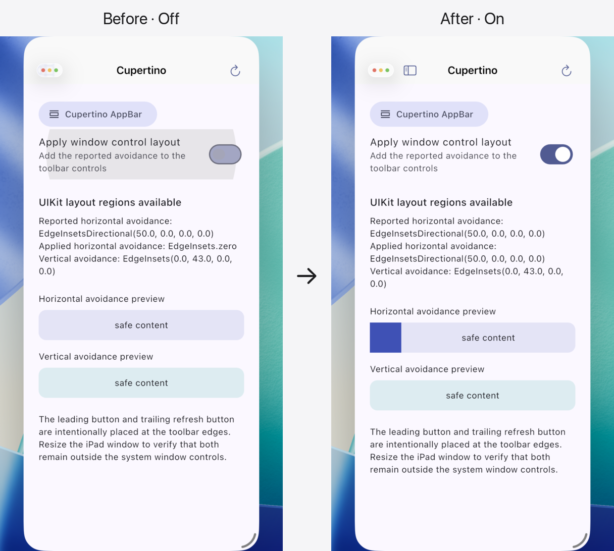
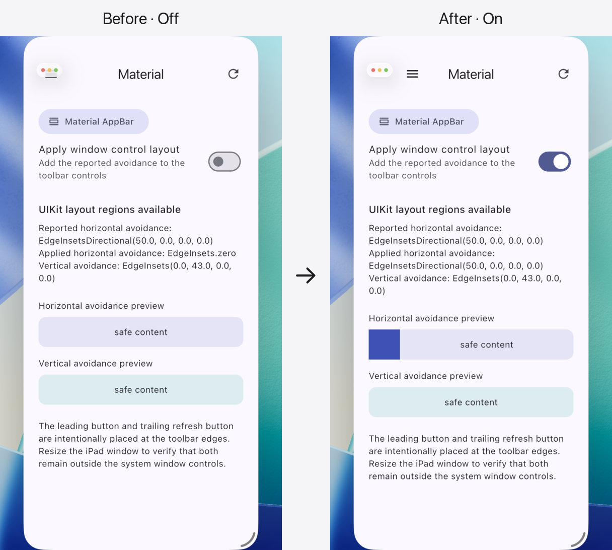

# ios_window_control_layout

![Package][pubdev-package]
![Likes][pubdev-likes]
![Popularity][pubdev-popularity]
![Points][pubdev-points]

EN / [中文](README_zh.md)

> **Keep Flutter content clear of iPadOS window controls** using UIKit's
> corner-adapted layout margins while retaining ownership of your AppBar,
> sidebar, and padding decisions.

## Screenshots

### Cupertino



<details>
<summary>Material</summary>



</details>

## Platform support

| Platform             | Behavior                                                              |
| -------------------- | --------------------------------------------------------------------- |
| iOS/iPadOS 26+       | Queries `UIView.LayoutRegion` from the current Flutter view.          |
| Earlier iOS versions | Returns `IosWindowControlLayoutData.zero`.                            |
| Other platforms      | Returns `IosWindowControlLayoutData.zero` without invoking a channel. |

## Getting started

```shell
flutter pub add ios_window_control_layout
```

## Usage

```dart
import 'package:ios_window_control_layout/ios_window_control_layout.dart';
```

Wrap the part of the widget tree that needs live updates:

```dart
IosWindowControlLayout(
  child: MaterialApp(home: MyHomePage()),
);
```

Read the current snapshot during build:

```dart
final layout = IosWindowControlLayout.of(context);
final toolbarInsets = layout.horizontalAvoidance;
```

`of` and `maybeOf` establish an inherited dependency. `read` and `maybeRead`
perform a non-listening lookup. The layout refreshes after its first frame, on
window metric changes, and when the application resumes. An application can
also request a refresh explicitly:

```dart
await IosWindowControlLayout.refresh(context);
```

For one-off access without adding the widget to the tree:

```dart
final layout = await IosWindowControlLayout.query();
```

Avoidance values are additional space, not replacements for a component's
ordinary padding. Keep the component's baseline padding and add the avoidance
to it, as in the complete example below.

<details>
<summary>Complete example</summary>

```dart
import 'package:flutter/material.dart';
import 'package:ios_window_control_layout/ios_window_control_layout.dart';

const _edgePadding = 16.0;

void main() => runApp(const ExampleApp());

class ExampleApp extends StatelessWidget {
  const ExampleApp({super.key});

  @override
  Widget build(BuildContext context) {
    return const IosWindowControlLayout(
      child: MaterialApp(home: ExamplePage()),
    );
  }
}

class ExamplePage extends StatelessWidget {
  const ExamplePage({super.key});

  @override
  Widget build(BuildContext context) {
    final layout = IosWindowControlLayout.of(context);
    final avoidance = layout.horizontalAvoidance;

    return Scaffold(
      appBar: AppBar(
        centerTitle: true,
        leadingWidth: kToolbarHeight + _edgePadding + avoidance.start,
        leading: Padding(
          padding: EdgeInsetsDirectional.only(
            start: _edgePadding + avoidance.start,
          ),
          child: IconButton(
            onPressed: () {},
            icon: const Icon(Icons.menu),
          ),
        ),
        title: const Text('Window control layout'),
        actions: [
          Padding(
            padding: EdgeInsetsDirectional.only(
              end: _edgePadding + avoidance.end,
            ),
            child: IconButton(
              onPressed: () => IosWindowControlLayout.refresh(context),
              icon: const Icon(Icons.refresh),
            ),
          ),
        ],
      ),
      body: Padding(
        padding: EdgeInsetsDirectional.only(
          start: _edgePadding + avoidance.start,
          end: _edgePadding + avoidance.end,
        ),
        child: Center(
          child: Text('Available: ${layout.isAvailable}'),
        ),
      ),
    );
  }
}
```

</details>

See the example app for manual Material and Cupertino AppBar integration. The
example deliberately places controls at both toolbar edges. Its window-control
layout switch is on by default; turn it off to compare the untreated layout,
and switch renderers while resizing an iPad window.

## Development

Run the complete non-device check suite:

```shell
make check
```

Run `make help` to list the available development commands.

## Contributing

Issues and pull requests are welcome. Run `make check` before submitting a
change.

## Donate

[!["Buy Me A Coffee"][buymeacoffee-badge]](https://www.buymeacoffee.com/d49cb87qgww)
[![Alipay][alipay-badge]][alipay-addr]
[![WechatPay][wechat-badge]][wechat-addr]

[![ETH][eth-badge]][eth-addr]
[![BTC][btc-badge]][btc-addr]

## License

This project is licensed under the MIT License. See [LICENSE](./LICENSE) for
the full license text.

```text
MIT License

Copyright (c) 2026 Fries_I23

Permission is hereby granted, free of charge, to any person obtaining a copy
of this software and associated documentation files (the "Software"), to deal
in the Software without restriction, including without limitation the rights
to use, copy, modify, merge, publish, distribute, sublicense, and/or sell
copies of the Software, and to permit persons to whom the Software is
furnished to do so, subject to the following conditions:

The above copyright notice and this permission notice shall be included in all
copies or substantial portions of the Software.

THE SOFTWARE IS PROVIDED "AS IS", WITHOUT WARRANTY OF ANY KIND, EXPRESS OR
IMPLIED, INCLUDING BUT NOT LIMITED TO THE WARRANTIES OF MERCHANTABILITY,
FITNESS FOR A PARTICULAR PURPOSE AND NONINFRINGEMENT. IN NO EVENT SHALL THE
AUTHORS OR COPYRIGHT HOLDERS BE LIABLE FOR ANY CLAIM, DAMAGES OR OTHER
LIABILITY, WHETHER IN AN ACTION OF CONTRACT, TORT OR OTHERWISE, ARISING FROM,
OUT OF OR IN CONNECTION WITH THE SOFTWARE OR THE USE OR OTHER DEALINGS IN THE
SOFTWARE.
```

[pubdev-package]: https://img.shields.io/pub/v/ios_window_control_layout.svg
[pubdev-likes]: https://img.shields.io/pub/likes/ios_window_control_layout?logo=dart
[pubdev-popularity]: https://img.shields.io/pub/popularity/ios_window_control_layout?logo=dart
[pubdev-points]: https://img.shields.io/pub/points/ios_window_control_layout?logo=dart
[buymeacoffee-badge]: https://img.shields.io/badge/Buy_Me_A_Coffee-FFDD00?style=for-the-badge&logo=buy-me-a-coffee&logoColor=black
[alipay-badge]: https://img.shields.io/badge/alipay-00A1E9?style=for-the-badge&logo=alipay&logoColor=white
[alipay-addr]: https://raw.githubusercontent.com/FriesI23/mhabit/main/docs/README/images/donate-alipay.jpg
[wechat-badge]: https://img.shields.io/badge/WeChat-07C160?style=for-the-badge&logo=wechat&logoColor=white
[wechat-addr]: https://raw.githubusercontent.com/FriesI23/mhabit/main/docs/README/images/donate-wechatpay.png
[eth-badge]: https://img.shields.io/badge/Ethereum-3C3C3D?style=for-the-badge&logo=Ethereum&logoColor=white
[eth-addr]: https://etherscan.io/address/0x35FC877Ef0234FbeABc51ad7fC64D9c1bE161f8F
[btc-badge]: https://img.shields.io/badge/Bitcoin-000000?style=for-the-badge&logo=bitcoin&logoColor=white
[btc-addr]: https://blockchair.com/bitcoin/address/bc1qz2vjews2fcscmvmcm5ctv47mj6236x9p26zk49
